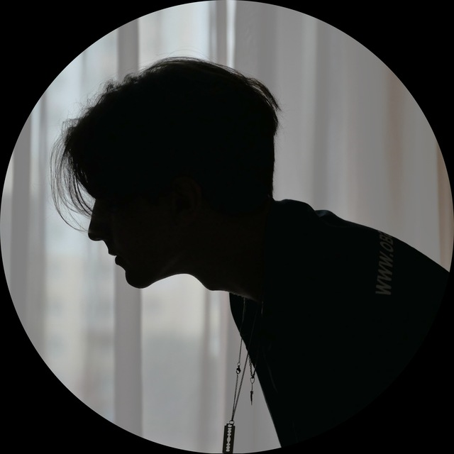

<h1 align="center">в общем-то соответственно >> тёма mdpka</h1>

<p align="center">
  
  
  
  
</p>


### 📋 Обо мне:
Я Тёма (mdpka), совмещаю IT и творчество: пишу код в своих проектах, поднимаю сервера, занимаюсь музыкальным продакшном, фото и видео съёмкой.

### 💻 Разработка и Инфраструктура
* **Full-stack на C#:** Разрабатываю как backend часть, так и frontend в рамках своих проектов. Есть завершенные релизы и текущие проекты в разработке.
* **Linux и Self-hosting:** Администрирую сервера, работаю с контейнеризацией в Docker'е, настраиваю SSH и сетевые порты. Поднял свой домашний сервер.

### 🎵 Музыкальный продакшн
* **FL Studio:** Пишу биты (как свои, так и заказные), свожу треки и занимаюсь саунд-дизайном. Выпускаю авторскую музыку на SoundCloud и стриминговых площадках.

### 🎬 Медиа и Видеопродакшн
* **Видеомонтаж:** Работаю в DaVinci Resolve. Монтирую Reels/Shorts, подкасты и клипы, занимаюсь цветокоррекцией.
* **Съемка и обработка:** Снимаю фото и видео на Lumix G90. Обрабатываю фото в Lightroom (есть опыт коммерческих съемок и репортажей с мероприятий).

---

### Мои проекты:
- [**Genesis**](https://github.com/mdpka-flp/Genesis) - Симуляция частиц, которая изначально создавалась для школьного проекта. Сейчас активно получает обновления с улучшениями.
- [**Flux**](https://github.com/mdpka-flp/Flux) - Обыкновенный плеер для прослушивания аудио. На данный момент готовится первый релиз, в последующих обновлениях он будет получать всё больше функционала.
- [**Minimized**](https://gamejolt.com/games/minimized/1026019) - Минималистичная игра головоломка. Полностью готова к релизу, но релиза нет. Хз, сколько ещё ждать)).
- [**kapuctagram**](https://github.com/mdpka-flp/KapuctagramSDK) - Мессенджер, разработка которого пока что приостановлена. Сейчас появилась возможность значительно улучшить его и повысить безопасность, но не знаю, как скоро я вернусь к нему.

### Ссылки и связь:
- [**Telegram (mdpka.flp)**](https://t.me/mdpkaaa) - Мой основной Telegram канал с событиями из моей жизни и информацией по творческим проектам.
- [**Telegram (mdpka.cs)**](https://t.me/mdpka_cs) - Второй Telegram канал по теме программирования.
- [**YouTube**](https://www.youtube.com/@mdpka) - Ютуб канал с видосами про музыку.
- [**mdpka-dots**](https://github.com/mdpka-flp/mdpka-dots) - Дотфайлы моего райса на CachyOS.
- **Мой Discord** - ```mdpka```

---

<h3 align="center">Всякая дичь:</h3>

<table align="center" border="0">
  <tr>
    <td valign="middle">
      
    </td>
    <td valign="middle">
      
    </td>
  </tr>
</table>

<p align="center">
  
</p>
